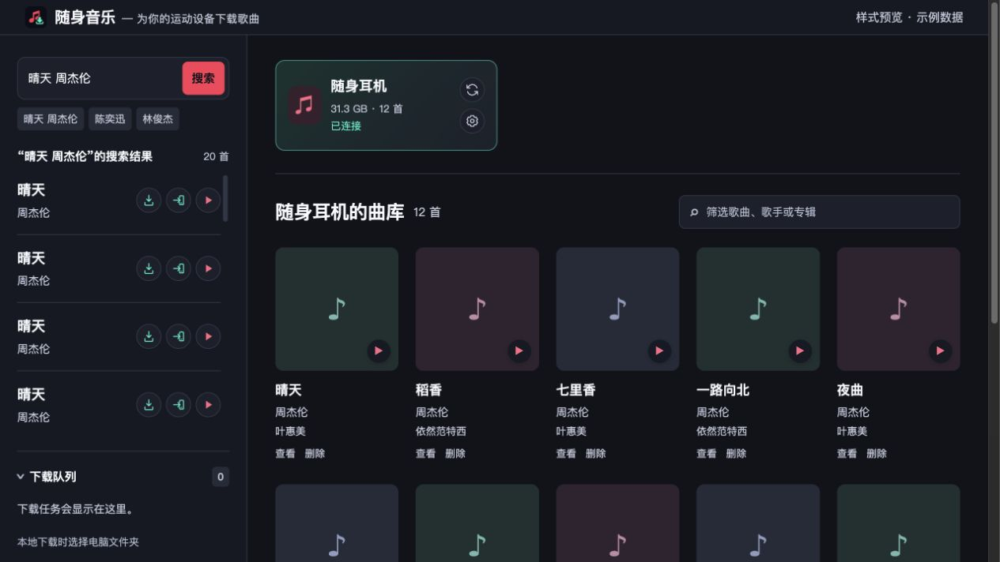

# 随身音乐

面向能独立播放本地音乐的智能手环、智能手表和蓝牙耳机的 Chrome / Edge Manifest V3 扩展。
在扩展中搜索歌曲、试听、下载 MP3，并管理设备的本地曲库与封面。无需本地客户端或常驻服务器。

项目目录和包名为 `portable-music-downloader`。当前支持通过 U 盘方式传歌、在系统中挂载为磁盘的设备，
以韶音 S710 为首个实体测试对象；其他设备需支持同样的目录传歌方式和 MP3 播放。

当前开发版本为 **0.2.0**，提供歌曲宝、歌曲海来源切换和普通音质 MP3 下载。已提交商店的是 **0.1.0**：Chrome 和 Edge 均已提交审核；Chrome 审核通过后手动发布，Edge 审核通过后自动上架。0.2.0 尚未提交，0.1.0 ZIP 保留。两个商店的资料记录在 [CHROMEWEBSTORE.md](CHROMEWEBSTORE.md)。本地可加载 `dist/` 调试。

## 本地加载

已经生成的 `dist/` 可直接加载，不用先运行开发命令。

1. Chrome 打开 `chrome://extensions`；Edge 打开 `edge://extensions`。
2. 开启“开发者模式”。
3. 点击“加载已解压的扩展程序”，选择本仓库的 **`dist` 文件夹**（里面直接包含 `manifest.json`）。
4. 在工具栏固定“随身音乐”，点击扩展图标，打开音乐管理标签页。
5. 在左侧搜索，点下载图标选择电脑测试文件夹；确认正常后，连接设备并进入 U 盘模式，点右侧“添加设备”卡片，在弹窗中选择设备并授权音乐目录。未发现时可在弹窗中点“手动选择目录”。

也可以解压 `release/portable-music-downloader-v0.2.0.zip`，加载解压后含 `manifest.json` 的目录；已提交的 0.1.0 包仍单独保留。
不要直接双击 `popup.html`；普通文件页面没有扩展的网络权限。
修改代码并重新构建后，需要在扩展管理页点击“重新加载”，再刷新音乐管理页。

## 功能与使用

- 页面左侧 1/4 用于搜索与下载，右侧 3/4 用于连接设备、管理设备和展示曲库。
- 应用 Logo 与扩展图标使用提供的音乐下载图案；页面采用浅色冷色调，白色面板、冰蓝背景与青色操作按钮。
- 顶部标题与副标题在同一行；绑定设备后，设备图标、名称编辑、容量条、歌曲数量与连接状态合并在曲库顶栏，筛选框居右。编辑图标打开设备管理，扫描图标重新读取曲库。
- 浏览器提供剩余容量时显示整盘占用；稳定版浏览器不可用时，容量条明确显示扫描到的 MP3 曲库占用。总容量来自设备发现接口，手动选择目录且未匹配设备时显示容量未知。
- 在扩展内搜索歌名/歌手，显示不同版本，保留最近 8 次搜索。
- 左侧选择歌曲宝或歌曲海，记住上次选择；切换后重新搜索当前关键词。播放与下载均使用该歌曲页面的普通音质播放源，不接入高品质网盘或 FLAC 通道。
- 每条搜索结果左侧上下显示歌名与歌手，右侧为下载、发送到设备和播放三个圆形图标；悬停显示功能提示，再次点播放图标可停止，页面没有底部播放器工具栏。
- 本地下载保存到单独选择的电脑文件夹；设备下载保存到右侧当前选中的设备音乐目录，不改变本地下载目录。
- 逐首获取播放地址、下载并校验格式/时长，再保存到对应目录。
- 第一版提供单个设备绑定，保存设备目录，支持重命名和移除设备记录；移除记录及未完成设备任务不会删除设备内的音乐。
- 自动发现可移动存储设备并监听插拔；未绑定时显示“添加设备”卡片，绑定后隐藏入口，移除设备记录后恢复。绑定后通过合并曲库栏显示名称、容量和连接状态。添加弹窗列出当前发现的设备，支持刷新与手动选择目录；刷新不请求目录权限。
- 首次连接设备时授权音乐目录，之后复用目录句柄；重新打开或接入时检查目录并读取已有曲库，不自动请求授权或开始下载。设备断开时暂停该目录的未完成任务。
- 连接设备、扫描曲库和播放已有歌曲只请求读取权限；发送歌曲或删除文件时才申请写入权限。目录暂不可写时仍可浏览、播放，并显示中文说明。
- 最近试听取得的地址会在内存中短暂复用；地址过期后最多重新解析一次。
- 同名文件自动增加编号；同一歌曲编号已在当前目录时阻止重复加入。
- 扫描设备目录及子目录内的 MP3，跳过常见系统元数据目录与 macOS `._` 文件，读取 ID3 标题、歌手、专辑及嵌入封面，展示设备曲库、筛选、播放、查看、确认删除。
- 重新打开管理页后，未完成队列变为暂停状态，点击继续后重新解析，不自动开始写盘。

通过 **chrome.system.storage** 发现可移动存储设备，通过 **File System Access API** 读写你选择的目录。
设备编号不是永久标识；已绑定设备仅在名称和容量组合唯一时自动关联，同名同容量或无法识别时保留手动选目录入口。旧目录只在名称匹配唯一且目录可读取时关联。
设备需要已经在系统中挂载为磁盘，并支持 MP3 文件播放；
本版通过所选音乐目录传歌，不支持蓝牙传文件、WebUSB 或厂商专有同步协议。下载完成后请在系统中安全弹出设备。
不要在下载/扫描期间用其他程序同时改写同一目录。

没有内嵌封面的旧 MP3 会显示占位图；从网站添加的歌曲可展示网站提供的封面。
专辑名依赖文件的真实 ID3 标签，网站没有该字段时不会虚构专辑。
本版不把网站封面重新嵌入 MP3，也不重编码音频。



## 音源与限制

0.2.0 支持歌曲宝和歌曲海，来源选择仅影响新的搜索；入队任务保留原来源，来源之间不会因歌曲编号相同而串歌或错误去重。旧队列和已下载歌曲记录默认归到歌曲宝。某个来源需要验证或达到限额时，仅暂停该来源的待处理任务。

多音源研究与实施记录见 [下一版本计划](docs/next-version-plan.md)。

歌曲宝搜索路径为 `/s/{关键词}`，详情 `/music/{id}`，通过 `/member/common-play-url`、`purpose=play` 获取播放器地址。歌曲海搜索路径为 `/search?s={关键词}`，详情 `/play/{id}`，通过 `/api/music` 获取普通播放地址。网站 HTML 作为数据解析，扩展不执行下载到的站点脚本。
普通、未加密的 MP3 保存前检查格式、解码时长和传输完整性；来源提供原始时长时额外检查是否仅返回短试听。
不经过高品质网盘入口，也不调用下载按钮的广告倒计时接口。

正常操作在扩展内完成。直接请求被安全检查拦截时，扩展会为当前来源创建自己的临时小窗，
平时最小化并复用该来源的页面会话，不逐首导航或新开普通标签页。两个来源的窗口、验证状态和请求队列分别保存。
检测到 CF 验证时会展开 520×680 的小窗，供你手动完成验证；也可点“打开验证窗口”重新打开同一个小窗。
请求成功后小窗重新最小化，空闲后回收；回收或手动关闭后，下一次操作会先尝试直接请求。
图片验证码需你输入；额度不足、请求过频或繁忙会暂停队列。扩展不会绕过这些限制。
不要关闭音乐管理页，当前下载随该页关闭而中断。

## 架构、开发与 CI

参考 `ileenhow/school-ebook-downloader` 本地架构，使用 Node 22、pnpm 10、TypeScript、Vite：

```text
src/background/    请求队列、页面会话、扩展图标入口
src/content/       必要时注入的单文件接口桥接
src/shared/        页面解析、消息类型、音频/ID3、目录写入、IndexedDB
src/popup/         搜索、曲库与队列界面（在独立标签页中运行）
public/            Manifest、图标
scripts/           构建校验、跨平台 ZIP 打包
.github/workflows/release.yml
```

```powershell
nvm use 22
corepack enable
pnpm install --frozen-lockfile
pnpm release:build
```

`release:build` **只执行本地**类型检查、构建、静态安全检查和 ZIP 打包，不运行单元测试，没有发布副作用。
`pnpm dev` 是持续构建到 `dist/`；每次变更后手动重新加载扩展。

界面图标来自 [Lucide](https://lucide.dev/)。`lucide-static` 只作为构建依赖；`pnpm icons:build` 提取用到的 13 个 SVG 生成本地 sprite，构建包不包含整套图标库、图标字体或运行时依赖。图标源文件保持原始几何形状，许可随扩展保存在 `assets/lucide-license.txt`。
仓库：[ileenhow/portable-music-downloader](https://github.com/ileenhow/portable-music-downloader)。
**Release** 使用单个 Ubuntu 任务构建。推送版本标签或手动运行时生成 ZIP 和 SHA-256；标签构建同时保存到 GitHub Release，安装包 artifact 保留 30 天。
Release 与 ebook 使用相同的 GitHub Environment 审批流程：构建完成后，Chrome 和 Edge 发布任务暂停。检查安装包后，在**同一次运行**中点击 **Review deployments**，选择商店，点击 **Approve and deploy**，继续发布原安装包。发布前校验 ZIP 的 SHA-256 与 Manifest 版本，不重新构建。
启用此流程前，仓库需公开，并在 `chrome-web-store`、`edge-addons` 两个环境中设置 Required reviewers。发布变量沿用 ebook 的 `CWS_*` / `EDGE_*` 名称，配置在本仓库的 Repository secrets，共八项必填，`EDGE_CERTIFICATION_NOTES` 可选。获取入口和操作步骤见 [构建与发布](docs/publishing.md)。

详细说明见 [架构](docs/architecture.md)、[本地测试步骤](docs/local-testing.md)及 [隐私说明](PRIVACY.md)。
